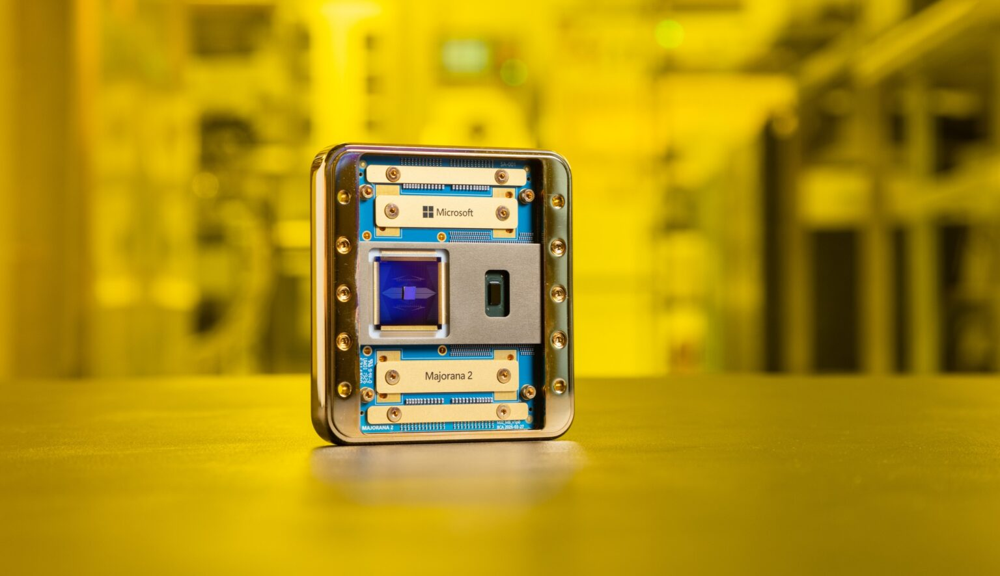
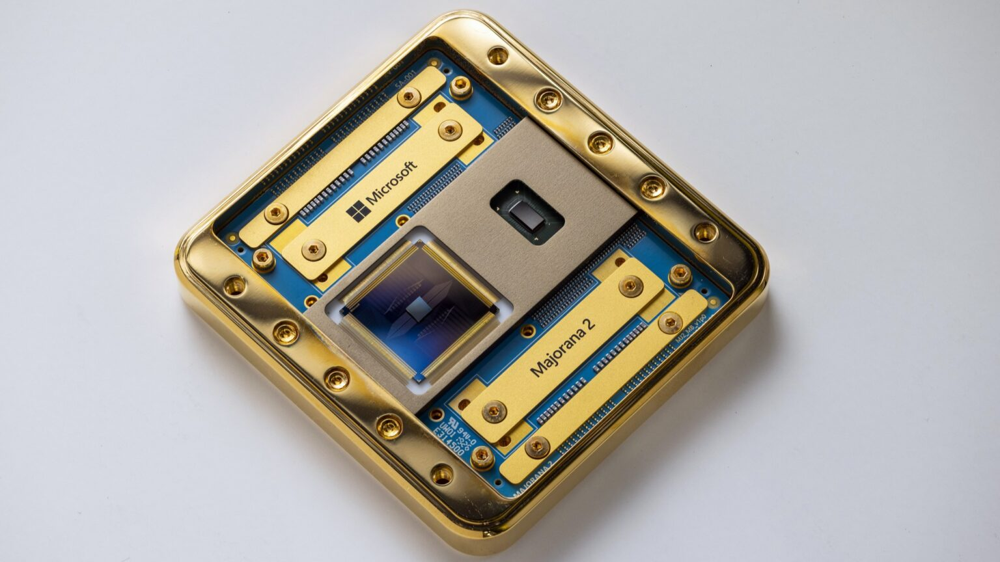
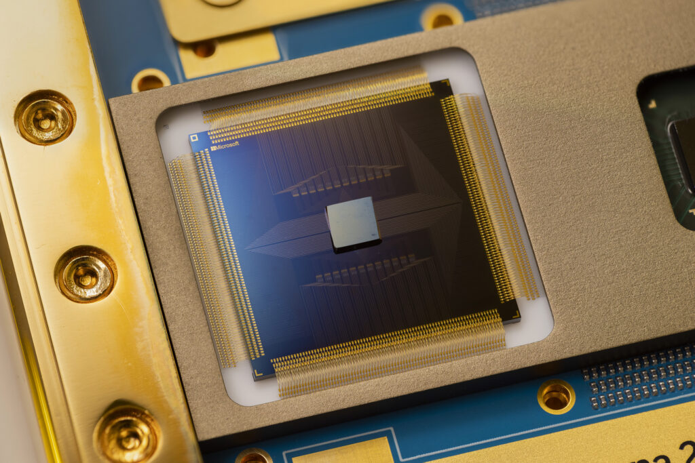
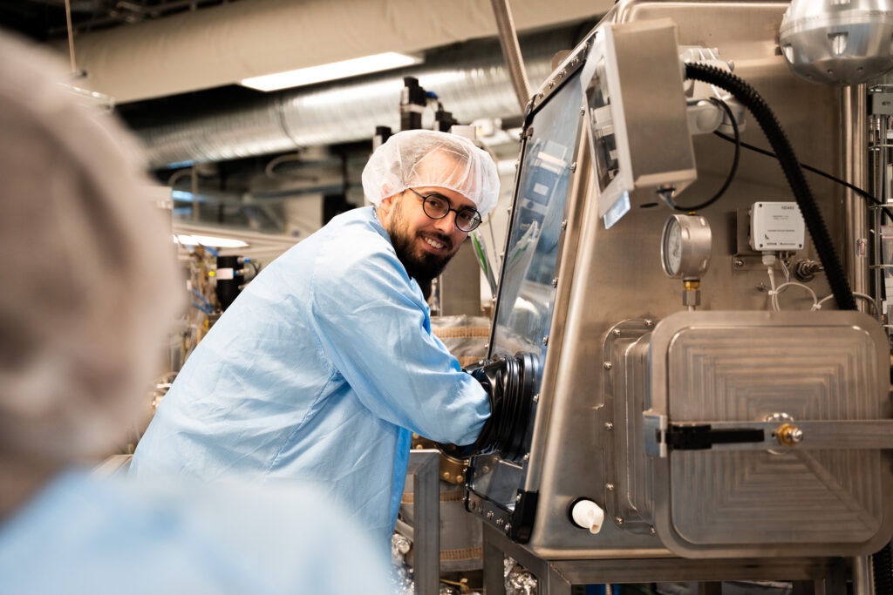

import MajoranaQuantum3D from '../../../components/MajoranaQuantum3D.astro';

<figure>
  
  <figcaption>Majorana 2, Microsoft's next-generation topological quantum chip built with Microsoft Discovery's agentic AI. Photo by John Brecher for Microsoft · <a href="https://news.microsoft.com/source/features/innovation/majorana-2-microsoft-discovery-agentic-ai/" target="_blank" rel="noopener noreferrer">Official Microsoft Source ↗</a></figcaption>
</figure>

## What is Majorana 2?

On June 2, 2026, Microsoft unveiled **Majorana 2**, its next-generation topological quantum processor engineered in partnership with **Microsoft Discovery's agentic AI**. Less than 18 months after the proof-of-concept Majorana 1, Majorana 2 moves from an aluminum superconductor stack to a next-generation **Indium Arsenide–Lead (`InAs-Pb`)** topological architecture.

The result is a **1,000-fold leap in qubit reliability**, cutting Microsoft's roadmap timeline in half toward a commercially valuable, fault-tolerant quantum computer by **2029**.

| Metric | Conventional / Prior Generation | Majorana 2 (`InAs-Pb`) |
| --- | --- | --- |
| **Mean Qubit Lifetime** | Microseconds to milliseconds | **20 seconds** (instances up to **1 minute**) |
| **Reliability Jump** | Baseline (Majorana 1) | **1,000× more reliable** |
| **Gate Operation Speed** | Variable | **~1 microsecond** |
| **Physical Qubit Size** | Millimeter-scale | **1/100 mm (~10 µm)** |
| **Target Scale Roadmap** | Long-horizon R&D | **Scalable Quantum Computer by 2029** |

Microsoft compares extending qubit lifetime from milliseconds to 20–60 seconds to inventing a phone battery that runs for nearly **three years on a single charge** instead of dying in one day.

---

## Interactive 3D Quantum & Qubit Simulation

Explore how Majorana 2 stores quantum information differently from ordinary qubits right in your browser:

1. **InAs-Pb Majorana Qubit**: Drag the scene, toggle electron **Parity (`|0⟩` ↔ `|1⟩`)**, and trigger a **Cosmic Noise Burst** to see how the lead (`Pb`) superconducting shield deflects local radiation without destroying non-local parity.
2. **3D Bloch Sphere**: Test standard single-qubit superposition gates (**H**, **X**, **Z**) and watch probabilities update live.
3. **Topological Braiding**: Observe how braiding Majorana Zero Modes in space-time executes hardware-protected quantum gates.

<MajoranaQuantum3D lang="en" />

---

## How Majorana 2 Works: Physics of `InAs-Pb` Topological Qubits

<figure>
  
  <figcaption>Majorana 2 chip assembly featuring the InAs-Pb topological superconductor stack. Photo by John Brecher for Microsoft.</figcaption>
</figure>

### 1. Why Lead (`Pb`) Instead of Aluminum?
Majorana 1 demonstrated a topological phase using an **aluminum** superconductor. However, tiny fluctuations and cosmic radiation can knock stray quasiparticles into fragile quantum states. Majorana 2 switches to **lead (`Pb`)** — the same heavy element trusted for radiation shielding in hospitals — coupled with an **Indium Arsenide (`InAs`)** semiconductor crystal. Lead provides a much larger superconducting energy gap and naturally suppresses cosmic-ray disruptions.

### 2. Non-Local Parity Encoding (Even vs. Odd Electrons)
Instead of storing `|0⟩` or `|1⟩` in a single fragile charge or magnetic flux localized at one tiny point, a topological qubit splits the state across **two Majorana Zero Modes (`γ₁` and `γ₂`)** separated at opposite ends of a microscopic `InAs` nanowire:

* State **`|0⟩` (Even parity)**: an **even** total number of electrons across billions of electrons on the wire.
* State **`|1⟩` (Odd parity)**: an **odd** total number of electrons across that wire.

Because a local electric spike or thermal jitter cannot simultaneously read or flip both ends of the wire at once, noise cannot easily tell whether the global electron count is even or odd — giving topological qubits **intrinsic hardware-level error protection**.

<figure>
  
  <figcaption>Atom-by-atom fabrication and microwave parity readout hardware for Majorana 2. Photo by John Brecher for Microsoft.</figcaption>
</figure>

---

## How Microsoft Discovery Agentic AI Accelerated It

Building Majorana 2 required tuning thousands of coupled parameters across crystal growth, impurity doping, cryogenics, microwave readout, and voltage control. Traditional manual trial-and-error took weeks per test cycle. Microsoft's quantum team integrated **Microsoft Discovery** — an agentic AI platform for Frontier R&D — across the entire engineering loop:

* **Atom-by-Atom Material Simulation**: AI agents simulate impurity placement in `InAs-Pb` crystal structures before physical fabrication, letting scientists target the highest-probability energy band in a single experiment instead of dozens.
* **Resynthesizing 20 Years of Siloed Data**: Autonomous agents correlate nearly two decades of experimental logs across disparate formats to surface hidden fabrication–performance patterns no single researcher could track manually.
* **Parallel Voltage Tuning in 3D**: Tuning a topological device requires sweeping dozens of gate voltages to detect single-electron parity stability. Specialized agents automate continuous sweeps, building 3D stability maps orders of magnitude faster than linear human tuning.
* **Noise & Fault Forensics**: Combining physics models with fab telemetry, an agent automatically traced anomalous noise back to an **uncalibrated temperature sensor** inside fabrication.

<figure>
  
  <figcaption>Microsoft Quantum Lab in Lyngby, Denmark, where scientists and AI agents co-design topological qubits. Photo courtesy of Microsoft.</figcaption>
</figure>

Microsoft Discovery is also **generally available** for external R&D teams (chemistry, energy, semiconductors, life sciences), alongside an early preview of the free local **Microsoft Discovery desktop app** powered by a GitHub Copilot account.

*Source & Full Story: [Microsoft Source — Majorana 2, made more reliable with Microsoft Discovery agentic AI](https://news.microsoft.com/source/features/innovation/majorana-2-microsoft-discovery-agentic-ai/)*
