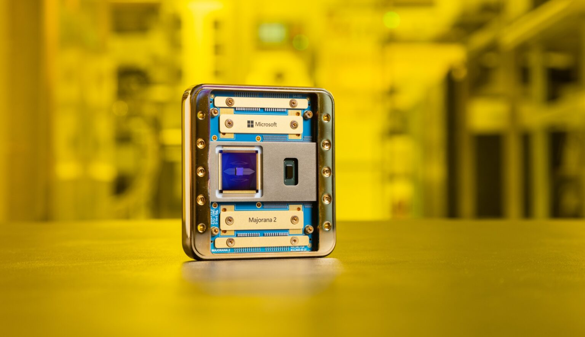
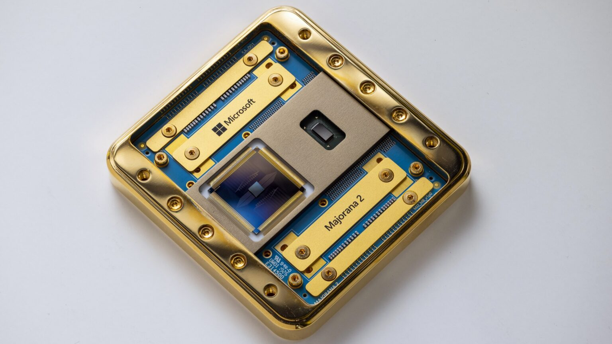
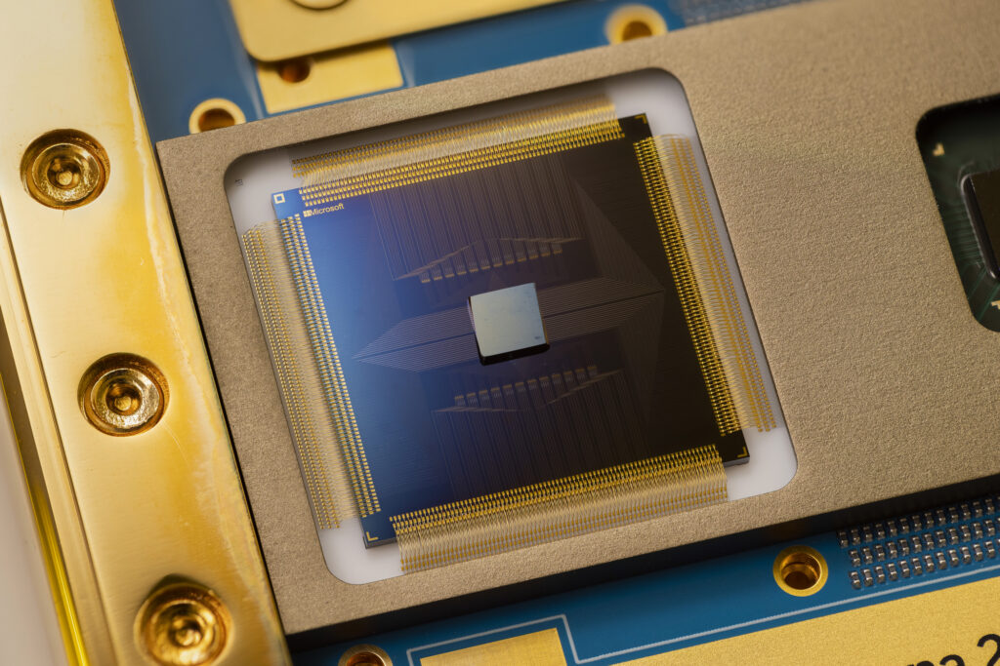
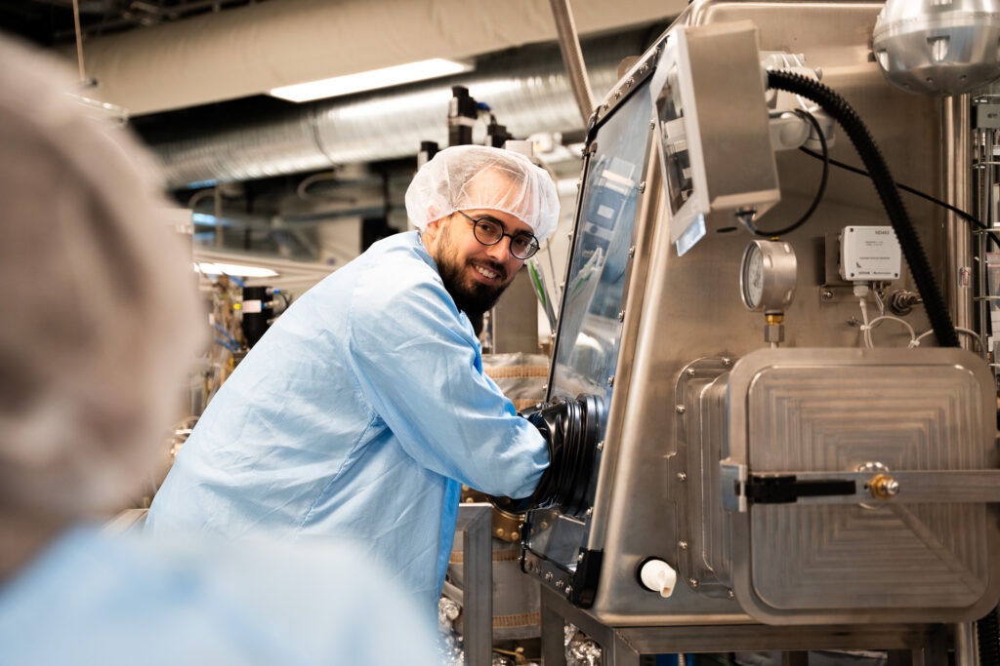

import MajoranaQuantum3D from '../../../../components/MajoranaQuantum3D.astro';

<figure>
  
  <figcaption>Majorana 2, cipul cuantic topologic de nouă generație dezvoltat cu ajutorul AI-ului agentic Microsoft Discovery. Foto: John Brecher pentru Microsoft · <a href="https://news.microsoft.com/source/features/innovation/majorana-2-microsoft-discovery-agentic-ai/" target="_blank" rel="noopener noreferrer">Sursa oficială Microsoft ↗</a></figcaption>
</figure>

## Ce este Majorana 2?

Pe 2 iunie 2026, Microsoft a prezentat **Majorana 2**, noul său procesor cuantic topologic creat împreună cu platforma de AI agentic **Microsoft Discovery**. La mai puțin de 18 luni după Majorana 1, noul cip înlocuiește supraconductorul de aluminiu cu o arhitectură avansată pe bază de **arseniură de indiu și plumb (`InAs-Pb`)**.

Rezultatul este o **fiabilitate de 1.000 de ori mai mare** a qubiților, reducând la jumătate termenul estimat de Microsoft pentru un computer cuantic scalabil și tolerant la erori — cu țintă în **2029**.

| Parametru | Generația anterioară | Majorana 2 (`InAs-Pb`) |
| --- | --- | --- |
| **Durată medie de viață a qubitului** | Microsecunde – milisecunde | **20 secunde** (până la **1 minut**) |
| **Salt de fiabilitate** | Nivel de bază (Majorana 1) | **De 1.000× mai fiabil** |
| **Viteză operație cuantică** | Variabilă | **~1 microsecundă** |
| **Dimensiune qubit** | Scară milimetrică | **1/100 mm (~10 µm)** |
| **Orizont scalabilitate** | R&D pe termen lung | **Computer cuantic scalabil până în 2029** |

Microsoft compară extinderea duratei de coerență de la milisecunde la 20–60 de secunde cu inventarea unei baterii de telefon care, în loc să se descarce într-o zi, ar rezista aproape **trei ani cu o singură încărcare**.

---

## Simulare 3D Interactivă: Cuantă, Qubit și Braiding

Explorează în timp real cum funcționează qubitul topologic Majorana 2 comparativ cu reprezentarea clasică pe sfera Bloch:

1. **Qubit Majorana InAs-Pb**: Rotește modelul 3D, comută **Paritatea (`|0⟩` ↔ `|1⟩`)** și declanșează un **Impuls de Radiație Cosmică** pentru a vedea cum ecranul de plumb (`Pb`) deviază perturbațiile fără a strica starea cuantică.
2. **Sfera Bloch 3D**: Aplică porți cuantice (**H**, **X**, **Z**) asupra vectorului de stare `|ψ⟩`.
3. **Împletire Topologică (Braiding)**: Urmărește împletirea liniilor de univers ale modurilor Majorana pentru porți logice protejate hardware.

<MajoranaQuantum3D lang="ro" />

---

## Cum funcționează: Fizica qubiților topologici `InAs-Pb`

<figure>
  
  <figcaption>Ansamblul cipului Majorana 2 cu stiva supraconductoare InAs-Pb. Foto: John Brecher pentru Microsoft.</figcaption>
</figure>

### 1. De ce plumb (`Pb`) în locul aluminiului?
Majorana 1 folosea aluminiu pentru starea supraconductoare. În **Majorana 2**, echipa a făcut tranziția la **plumb (`Pb`)** combinat cu semiconductorul **arseniură de indiu (`InAs`)**. Exact așa cum plumbul protejează oamenii și echipamentele de radiații în spitale, în cipul cuantic acesta oferă un decalaj energetic mai mare și ecranează qubiții fragili împotriva radiației cosmice.

### 2. Codificare prin paritate non-locală (Par vs. Impar)
Un qubit topologic nu stochează informația într-un singur electron sau flux magnetic punctiform. Starea este divizată în **două moduri zero Majorana (`γ₁` și `γ₂`)** aflate la capetele opuse ale unui nanofir `InAs`:

* Starea **`|0⟩` (Paritate pară)**: număr **par** de electroni din miliardele aflate pe nanofir.
* Starea **`|1⟩` (Paritate impară)**: număr **impar** de electroni pe nanofir.

Deoarece zgomotul termic sau electromagnetic local nu poate accesa simultan ambele capete ale firului, sistemul obține **protecție nativă la nivel hardware** împotriva erorilor de decoerență.

<figure>
  
  <figcaption>Fabricare atom cu atom și sistem de citire a parității pentru Majorana 2. Foto: John Brecher pentru Microsoft.</figcaption>
</figure>

---

## Rolul AI-ului Agentic Microsoft Discovery

Construirea Majorana 2 a implicat mii de variabile interdependente (creștere cristalină, impurități controlate atomic, criogenie, măsurători RF). Echipa a folosit agenți autonomi din **Microsoft Discovery**:

* **Design atomic prin simulare**: Agenții simulează cantitatea optimă de impurități necesară în rețeaua cristalină înainte de experimentul fizic, reducând săptămâni de încercări la o singură validare precisă.
* **Corelarea a ~20 de ani de date izolate**: Agenții AI resintetizează date istorice în formate eterogene și descoperă corelații invizibile unui singur cercetător.
* **Calibrare paralelă a tensiunilor 3D**: În locul ajustării liniare manuale (care dura săptămâni), agenții reglează simultan zeci de tensiuni electrice și cartografiază 3D punctele stabile pentru măsurarea parității.
* **Identificarea erorilor ascunse**: Un agent care combină fizica dispozitivului cu telemetria de laborator a depistat automat un **senzor de temperatură decalibrat** care altera datele de fabricație.

<figure>
  
  <figcaption>Laboratorul Microsoft Quantum din Lyngby, Danemarca, unde fizicienii și agenții AI proiectează qubiții topologici. Foto: Microsoft.</figcaption>
</figure>

Microsoft Discovery este disponibil comercial pentru echipe de cercetare în materiale, chimie, energie și științele vieții, iar o versiune locală gratuită (**Microsoft Discovery app** în preview) poate fi rulată cu un cont GitHub Copilot.

*Articol original: [Microsoft Source — Majorana 2, made more reliable with Microsoft Discovery agentic AI](https://news.microsoft.com/source/features/innovation/majorana-2-microsoft-discovery-agentic-ai/)*
