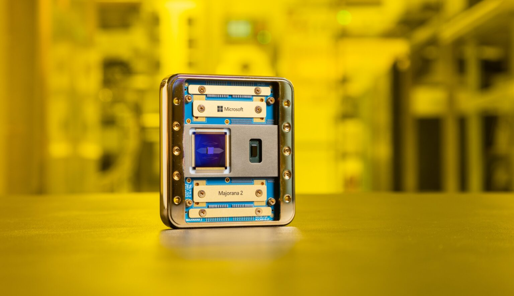
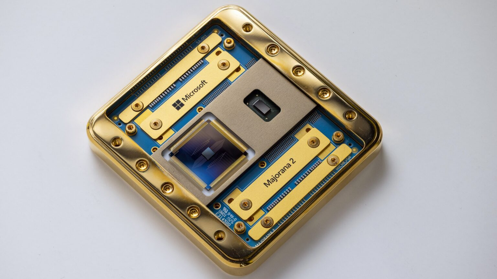
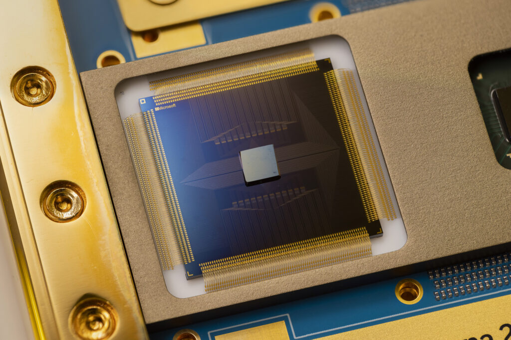
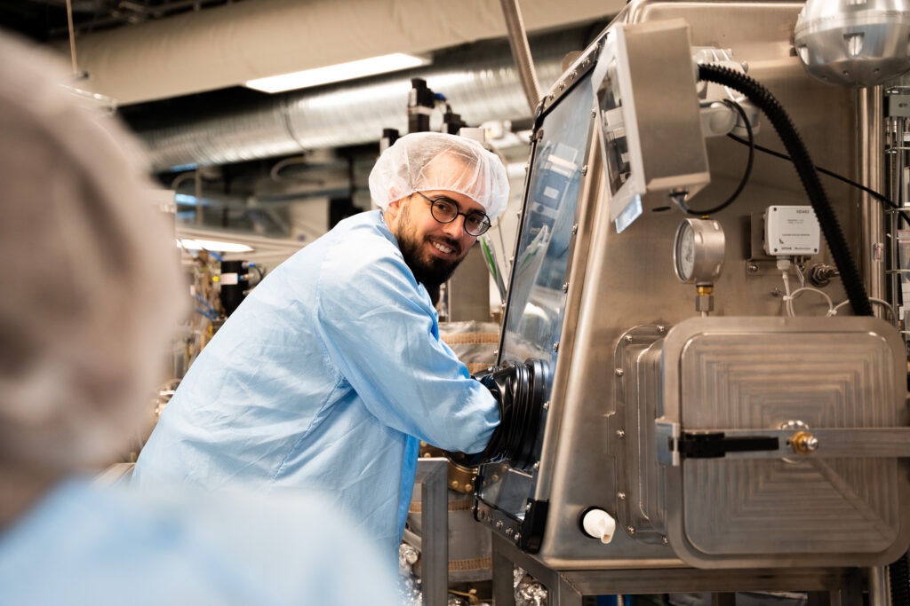

import MajoranaQuantum3D from '../../../../components/MajoranaQuantum3D.astro';

<figure>
  
  <figcaption>Majorana 2 — квантовый чип нового поколения, созданный при помощи агентного ИИ Microsoft Discovery. Фото: John Brecher для Microsoft · <a href="https://news.microsoft.com/source/features/innovation/majorana-2-microsoft-discovery-agentic-ai/" target="_blank" rel="noopener noreferrer">Официальный источник Microsoft ↗</a></figcaption>
</figure>

## Что такое Majorana 2?

2 июня 2026 года Microsoft представила **Majorana 2** — топологический квантовый процессор нового поколения, разработанный с активным применением агентной ИИ-платформы **Microsoft Discovery**. Спустя менее чем 18 месяцев после первого прототипа Majorana 1 инженеры перешли от алюминиевого сверхпроводника к новому стеку материалов **арсенид индия + свинец (`InAs-Pb`)**.

Главный итог: **надёжность кубитов выросла в 1 000 раз**, что позволило Microsoft сократить дорожную карту вдвое и нацелиться на масштабируемый отказоустойчивый квантовый компьютер уже к **2029 году**.

| Показатель | Обычные / прошлые кубиты | Majorana 2 (`InAs-Pb`) |
| --- | --- | --- |
| **Среднее время жизни кубита** | Микросекунды – миллисекунды | **20 секунд** (до **1 минуты**) |
| **Прирост надёжности** | База (Majorana 1) | **В 1 000× надёжнее** |
| **Скорость операций** | Зависит от платформы | **~1 микросекунда** |
| **Размер кубита** | Миллиметровый масштаб | **1/100 мм (~10 мкм)** |
| **Горизонт масштабирования** | Длительный R&D | **Масштабируемый компьютер к 2029 г.** |

В Microsoft сравнивают скачок времени жизни состояния с миллисекунд до 20–60 секунд с изобретением аккумулятора для смартфона, который вместо одного дня держит заряд **почти три года**.

---

## Интерактивная 3D-симуляция работы кванта и кубита

Покрутите сцену мышью или пальцем и проверьте три режима прямо в браузере:

1. **Кубит Majorana (`InAs-Pb`)**: переключайте **чётность электронов (`|0⟩` ↔ `|1⟩`)** и нажмите **«Всплеск космического шума»**, чтобы увидеть, как свинцовый сверхпроводящий экран (`Pb`) отражает внешние помехи, не разрушая квантовое состояние.
2. **3D Сфера Блоха**: нажимайте квантовые гейты (**H**, **X**, **Z**), наблюдая вращение вектора состояния `|ψ⟩` и вероятности `P(|0⟩)` / `P(|1⟩)`.
3. **Топологическое плетение (Braiding)**: посмотрите, как перестановка майорановских мод в пространстве-времени выполняет аппаратно-защищённые квантовые гейты.

<MajoranaQuantum3D lang="ru" />

---

## Как это работает: физика топологического кубита `InAs-Pb`

<figure>
  
  <figcaption>Конструкция квантового процессора Majorana 2 на базе топокондуктора InAs-Pb. Фото: John Brecher для Microsoft.</figcaption>
</figure>

### 1. Почему вместо алюминия выбрали свинец (`Pb`)?
В Majorana 1 сверхпроводником служил алюминий. В **Majorana 2** команда перешла на **свинец (`Pb`)** в связке с полупроводниковым кристаллом **арсенида индия (`InAs`)**. Как свинец защищает оборудование и врачей от радиации в медицине и промышленности, так и в квантовом чипе сверхпроводящий свинцовый слой с более широкой энергетической щелью экранирует хрупкие кубиты от космического излучения и блуждающих квазичастиц.

### 2. Нелокальное хранение через чётность электронов
Обычный кубит хранит бит информации локально — в заряде или магнитном потоке одной точки, поэтому любая локальная помеха сразу сбивает суперпозицию. В топологическом кубите Majorana 2 квантовое состояние разделено между **двумя майорановскими нулевыми модами (`γ₁` и `γ₂`)**, разнесёнными по разным концам микроскопического нанопровода `InAs`:

* **`|0⟩` (Чётная чётность)**: на проводе **чётное** суммарное число электронов (из миллиардов).
* **`|1⟩` (Нечётная чётность)**: на проводе **нечётное** суммарное число электронов.

Чтобы разрушить или «подсмотреть» состояние, помеха должна одновременно затронуть оба разнесённых конца провода — поэтому защита от ошибок заложена в саму **топологию и физику материала**.

<figure>
  
  <figcaption>Атомарная сборка структур InAs-Pb и модуль считывания чётности Majorana 2. Фото: John Brecher для Microsoft.</figcaption>
</figure>

---

## Как агентный ИИ Microsoft Discovery ускорил разработку

Создание квантового чипа связывает воедино физику кристаллов, примеси на уровне отдельных атомов, криогенику, СВЧ-считывание и подбор десятков управляющих напряжений. Платформа **Microsoft Discovery** подключила специализированных ИИ-агентов ко всему циклу R&D:

* **Атомарный подбор материалов**: вместо недель слепых экспериментов с концентрацией примесей агенты заранее просчитывают нужную энергетическую структуру, чтобы выйти на точный «рецепт» почти с первой попытки.
* **Синтез ~20 лет накопленных данных**: ИИ-агенты объединяют разрозненные базы экспериментов в разных форматах и находят скрытые корреляции между этапами изготовления и качеством кубитов.
* **Параллельная настройка 3D-карт напряжений**: измерение и вывод кубита в рабочую точку раньше занимали недели ручной работы. Агент непрерывно подбирает напряжения на затворах **параллельно**, строя трёхмерную карту оптимальных режимов на порядки быстрее человека.
* **Поиск аппаратных сбоев**: сопоставив физическую модель с сырыми логами производства, агент сам выявил **раскалиброванный датчик температуры**, искажавший серию тестов.

<figure>
  
  <figcaption>Квантовая лаборатория Microsoft в Люнгбю (Дания), где инженеры и ИИ-агенты совместно создают топологические кубиты. Фото: Microsoft.</figcaption>
</figure>

Вместе с анонсом чипа платформа **Microsoft Discovery** вышла в общую доступность для научных и промышленных команд (химия, материалы, энергетика, бионауки), а также появилось бесплатное локальное приложение **Microsoft Discovery app** (раннее превью с аккаунтом GitHub Copilot).

*Первоисточник: [Microsoft Source — Majorana 2, made more reliable with Microsoft Discovery agentic AI](https://news.microsoft.com/source/features/innovation/majorana-2-microsoft-discovery-agentic-ai/)*
